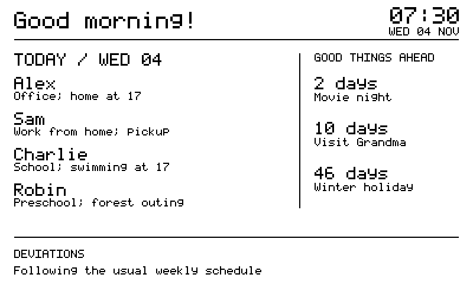
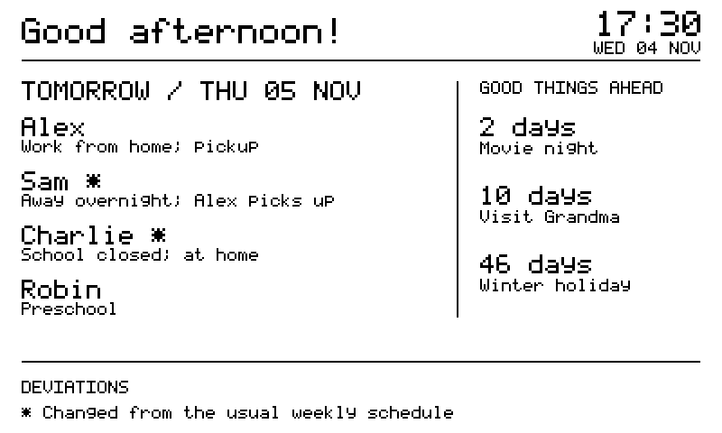

# Family dashboard

<p align="center">
  
  
</p>

An e-paper dashboard that shows your family's plans and upcoming events on a
Raspberry Pi Zero 2 W. It uses C++26 named modules and cross-compiles directly
on macOS for 64-bit Raspberry Pi OS (Debian Trixie).

## Build and deploy

On your Mac, install the build tools, build the executable, and upload it to
the Pi:

```sh
brew install llvm lld cmake ninja python@3.14
./scripts/build.sh
./scripts/deploy.sh your-user@zero.local
```

Use your Pi username and hostname in the last command. With no argument,
`./scripts/deploy.sh` uses `cklein@zero.local`. The script uses your normal
SSH login and installs the executable at `~/.local/bin/family-dashboard` on
the Pi.

## Display test

Use the Waveshare 7.5-inch **black-and-white V2 (800×480)** display with its
Driver HAT. Follow the Raspberry Pi connection instructions in the
[Waveshare HAT manual](https://www.waveshare.com/wiki/7.5inch_e-Paper_HAT_Manual).

On the Pi, enable SPI, grant your account access to the display, and reboot:

```sh
sudo raspi-config nonint do_spi 0
sudo usermod -aG spi,gpio "$USER"
sudo reboot
```

Reconnect to the Pi and run a full refresh with the built-in test image:

```sh
~/.local/bin/family-dashboard --test --full
```

Expect a border, greeting, and checker pattern. A full refresh may flash the
screen. The image stays visible when the display goes to sleep. If access fails,
the binary reports the device and suggests how to fix it.

## Dashboard configuration

On your Mac, copy the fictional example and edit `dashboard.yaml` with your
family's names and plans. Git ignores your local file.

```sh
cp dashboard.example.yaml dashboard.yaml
```

Upload your configuration to the Pi:

```sh
./scripts/deploy-config.sh your-user@zero.local
```

The script uses the same default SSH target as `deploy.sh` and installs the file
at `~/.config/family-dashboard/dashboard.yaml`. After editing your local plans,
rerun `deploy-config.sh`. Each refresh reads the file again. On the Pi, try your
configured dashboard:

```sh
~/.local/bin/family-dashboard
```

Run `~/.local/bin/family-dashboard --help` for supported options, including how to
override the layout or refresh style. For a manual run, the binary looks for
`dashboard.yaml` in the current directory first, then in
`~/.config/family-dashboard/`. Use `--config PATH` to choose a different file.

### Display layouts

Both layouts show the local date and time, family plans, and countdowns to
upcoming events. Before 17:00, the dashboard shows today's plans. From 17:00,
it shows tomorrow's plans. Use `sudo raspi-config` if you need to change the
Pi's time zone.

### YAML reference

- **Weekly schedule.** List exactly four people in `members`, each with an
  `id` and `name`, in display order. Under `weekly`, use weekday keys
  `monday` through `sunday` and give each person a short summary. Blank or
  omitted entries show `No plans`.
- **Deviations.** Use `deviations` to replace a person's summary for a specific
  date. Everyone else keeps their usual plans. A blank summary shows
  `No plans`. The display marks changed plans with an asterisk.
- **Good things ahead.** Under `good-things`, give each event a `date` and
  `title`. The display shows up to three upcoming events in date order, with
  countdowns from today. Events can share a date.

Dates use `YYYY-MM-DD`. Standard YAML quoting, comments, and folded text
(`>-`) work. Quote text containing `: ` or ` #`. Use plain text for summaries
and keep them short enough to fit in two lines. The parser rejects duplicate
keys or member IDs, unknown fields or members, and invalid dates.

## Schedule updates with systemd

Once a manual refresh works, run these commands on the Pi as the same user:

```sh
mkdir -p ~/.config/systemd/user
~/.local/bin/family-dashboard --systemd-service > ~/.config/systemd/user/family-dashboard.service
~/.local/bin/family-dashboard --systemd-timer > ~/.config/systemd/user/family-dashboard.timer
systemctl --user daemon-reload
systemctl --user enable --now family-dashboard.timer
```

The timer refreshes the display every minute. To start it at boot and keep it
running after logout, run `sudo loginctl enable-linger "$USER"`.

The service uses your Pi account, the Pi's local time zone, and
`~/.config/family-dashboard/dashboard.yaml` by default. Pass layout, refresh,
or `--config PATH` options to `--systemd-service` to use those settings for
scheduled runs.

Check the next run and follow the service logs:

```sh
systemctl --user list-timers family-dashboard.timer
journalctl --user -u family-dashboard.service -f
```

To stop scheduled updates, run
`systemctl --user disable --now family-dashboard.timer`.

## Advanced Topics

### VS Code

Install the recommended **clangd** extension
(`llvm-vs-code-extensions.vscode-clangd`). The workspace uses Homebrew clangd
for C++26 and named modules, and keeps Microsoft's C++ extension available for
debugging with IntelliSense disabled.

Generate the native build and its compilation database:

```sh
cmake -S . -B build/macos -G Ninja \
  -DCMAKE_CXX_COMPILER="$(brew --prefix llvm)/bin/clang++"
cmake --build build/macos
```

The database lives at `build/macos/compile_commands.json`. The `.clangd`
configuration locates it and lets clangd build and cache its module artifacts.
Keep the imports in `main.cpp` before the standard headers to avoid conflicts
with libc++ declarations, and rebuild after changing module imports. If
Homebrew LLVM is installed outside `/opt/homebrew/opt/llvm`, adjust the paths
in `.vscode`.

Run **Developer: Reload Window** after switching extensions or
**clangd: Restart language server** if diagnostics become stale. Use the CMake
build to confirm compiler errors. [clangd module support](https://clangd.llvm.org/features#experimental-c20-modules-support)

### Font coverage

The built-in 5×7 font covers printable ASCII, `ÅÄÖåäö`, `Éé`, the degree sign,
euro sign, typographic quotes, dashes, ellipsis, and bullet. Text is decoded as
UTF-8 and centered by character count. Unsupported characters and malformed
UTF-8 display as `?`. Use precomposed letters for accents.

### Verification

Build the native target as shown above, then run:

```sh
ctest --test-dir build/macos --output-on-failure
```

The tests cover configuration validation, weekly schedules, dated overrides,
countdowns, framebuffer and UTF-8 rendering, minute updates, and midnight
rollover. The ARM64 build compiles the SPI and GPIO code. Verify refresh behavior
on the Pi with the attached panel.

### Coding style

C++ sources and modules use Allman braces with two-space indentation in
`.clang-format`. Use `using namespace std;` in source files and place it
after the declaration and imports in module units. See `AGENTS.md` for the
project conventions.

Install the Git hooks once per clone:

```sh
brew install pre-commit
pre-commit install
```

The hooks run Clang-format for C++, Yamllint for YAML, and ShellCheck for shell
scripts. Stage any formatting fixes and retry the commit.

### Toolchain and compatibility

Homebrew Clang and LLD build a static ARM64 Linux executable at
`build/arm64-native/family-dashboard`. The first build downloads Debian Trixie
ARM64 packages and extracts headers and libraries into `build/sysroot-arm64`.
It checks package SHA-256 hashes against the Debian package index fetched over
HTTPS and records package names, versions, URLs, and hashes in
`build/sysroot-arm64/packages.json`.

CMake and Ninja track named-module dependencies using Clang's module scanner.
`cmake/zero.cmake` targets `aarch64-linux-gnu` and Cortex-A53 and uses the local
sysroot. Static linking bundles glibc and the C++ runtime. The GPIO v2 API
requires Linux 5.10 or newer.

Use `LLVM_ROOT`, `LLD_ROOT`, and `PYTHON` to override the build script's Homebrew
tool locations. To refresh the target packages, delete `build/sysroot-arm64`
and the relevant downloads in `build/`.

The build verifies the SHA-256 hash of yaml-cpp 0.8.0 and links it statically
into both the macOS and Pi builds. CMake caches the source in each build
directory. If `build/dependencies/yaml-cpp-0.8.0.tar.gz` exists, CMake uses it
and applies the same hash check.
[yaml-cpp 0.8.0 source](https://github.com/jbeder/yaml-cpp/tree/0.8.0)

### Display refresh modes

Fast refresh updates the whole panel and may flash. It follows the
`EPD_7IN5_V2_Init_Fast` initialization and uses the same image transfer and sleep
sequence as full refresh. The binary logs refresh timing.
[Waveshare reference driver](https://github.com/waveshareteam/e-Paper/blob/master/RaspberryPi_JetsonNano/c/lib/e-Paper/EPD_7in5_V2.c)

Partial refresh wakes the panel and uses the retained visible image without
restoring controller RAM. If afterimages build up, run a full refresh with
`~/.local/bin/family-dashboard --full`. Check timing, contrast, and ghosting on
the physical panel.

### Troubleshooting display access and systemd

- Check device permissions with `ls -l /dev/spidev0.0 /dev/gpiochip*` and group
  membership with `id`. Reboot after changing groups so the systemd user manager
  picks up the new membership.
- If you used the old system-wide installer, disable its timer with
  `sudo systemctl disable --now family-dashboard.timer` before enabling the
  user timer.
- If the systemd user manager uses `XDG_CONFIG_HOME`, put the unit files in
  `$XDG_CONFIG_HOME/systemd/user/`.
- If the Pi uses a volatile journal, read the service logs with
  `sudo journalctl _SYSTEMD_USER_UNIT=family-dashboard.service _UID="$(id -u)" -f`.
